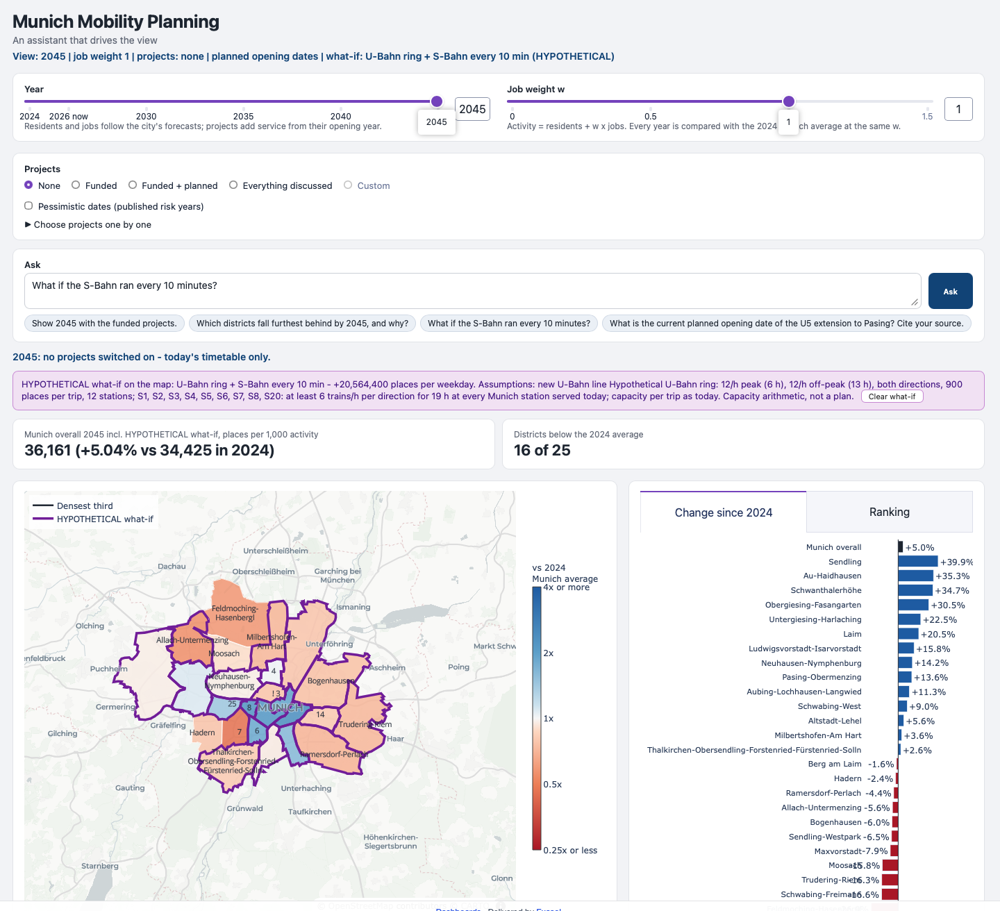

<h1 align="center">Munich Mobility Agents</h1>

  <picture>
    <source media="(prefers-color-scheme: dark)" srcset="docs/kindl-exasol-dark.png">
    
  </picture>

<h3 align="center">A hands-on tutorial for AI-assisted analytics on Exasol Personal</h3>

You load open data from the City of Munich into a local [Exasol](https://www.exasol.com) database on your laptop. Then you work with an AI coding agent, Codex or Claude Code, to build a series of live dashboards that answer one planning question, step by step:

> **How well is each Munich district served by public transport, now and as the city grows to 2045, and what do the planned rail and tram projects change?**

You describe what you want to see and why; the agent writes the SQL and the dashboards. The only prerequisite is the **[Exasol Personal Local Starter Kit](https://github.com/exasol-labs/exasol-personal-local-starterkit)**. The dataset is an 18 MB zip on this repo's [Releases page](https://github.com/exasol-labs/munich-mobility-planning-agents/releases).

## The path

1. [Set up the Exasol Personal Local Starter Kit](tutorial/01-setup-starter-kit.md): database, Dash Server, your agent connected over MCP
2. [Load the Munich data](tutorial/02-load-data.md): download the zip, load it with `exakit data-load`
3. [First questions](tutorial/03-first-questions.md): get to know the data with your agent
4. [v1: today, per resident](tutorial/04-v1-residents.md)
5. [v2: residents and jobs](tutorial/05-v2-jobs.md)
6. [v3: forecast to 2045](tutorial/06-v3-forecast.md)
7. [v4: rail and tram scenarios](tutorial/07-v4-scenarios.md)
8. [v5: an assistant on the page](tutorial/08-v5-assistant.md) (needs an OpenAI API key)
9. [The cycling series: your turn](tutorial/09-cycling-series.md)
10. [Troubleshooting](tutorial/10-troubleshooting.md)

  
   
  <em>The dashboard after the tutorial is complete. The assistant has put a hypothetical what-if on the map: a U-Bahn ring and S-Bahn trains every 10 minutes.</em>

## Repo map

| Path | What it is |
|---|---|
| [tutorial/](tutorial/) | The chapters above |
| [AGENTS.md](AGENTS.md) | Standing instructions for the agent: ground rules, the data, building on Dash Server |
| [data/](data/README.md) | The table reference, the data model, sources and licenses, and the curated list of rail and tram projects |
| [research/](research/README.md) | The research behind the forecast and the scenarios, the reference numbers, and the context pack for the v5 assistant |
| [secrets/](secrets/README.md) | Where your OpenAI key goes (gitignored) |
| [scripts/prepare_dataset.py](scripts/prepare_dataset.py) | Optional: rebuilds the dataset from the Munich open data portal download |

## About the data
The MVV data is the **scheduled** timetable. It has no passenger counts, delays or crowding, so "well served" means *capacity offered*, not use. Jobs per district are a modeled city estimate, and the population between 2024 and 2045 is interpolated to the official forecast.

## Sources and links
- **Data:** the Munich open data portal ([opendata.muenchen.de](https://opendata.muenchen.de)), the MVV GTFS timetable, the City of Munich's Demografiebericht and Erwerbstätigenprognose. Details and licenses are in [data/README.md](data/README.md).
- **Tools:** [Exasol Personal](https://www.exasol.com/personal/) · [Starter Kit](https://github.com/exasol-labs/exasol-personal-local-starterkit) · [Dash Server](https://github.com/exasol-labs/dash-server) · [Exasol MCP server](https://github.com/exasol/mcp-server)
